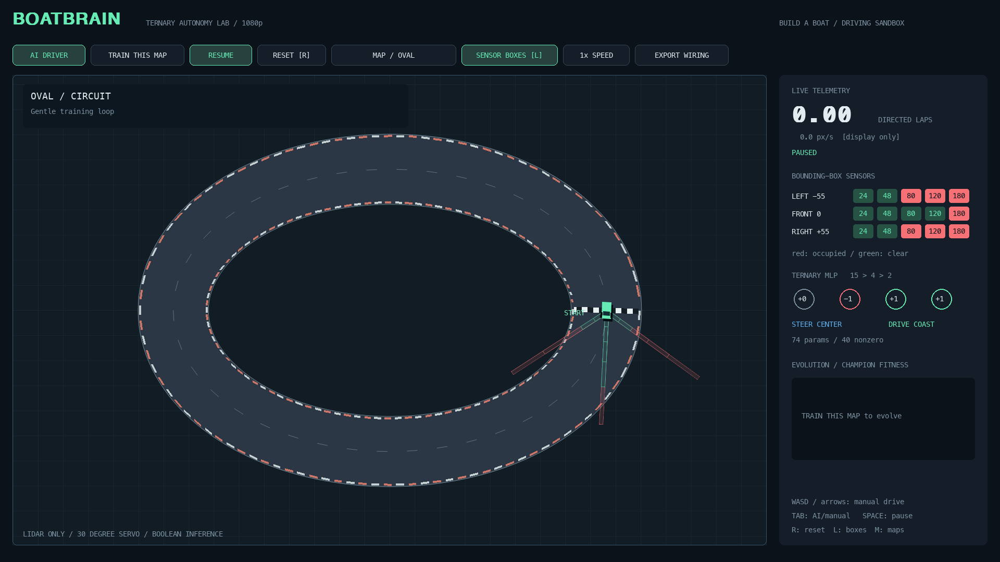

# BOATBRAIN

A local Pygame driving laboratory for a manually wired **Build a Boat for Treasure** controller. Evolve a tiny ternary MLP from driving rewards, watch it drive, and export the Boolean circuit.



The lab opens at **1920 × 1080**, with native-resolution vector roads, antialiased edges and larger text. It supports resizing both smaller and larger, camera zoom, and eight selectable maps. Smaller windows fit the full 1080p interface with aspect-preserving scaling; mouse controls follow the scaled layout. See the [map guide and previews](docs/MAPS.md).

## Run

Python 3.11+ and [uv](https://docs.astral.sh/uv/) are required. This checkout has its own `.venv` created using uv, with locked dependencies in `uv.lock`.

```sh
uv sync --python 3.11
uv run boatbrain play
```

If `uv` is not on PATH in this machine's shell, use `python3.11 -m uv` instead of `uv` in the commands. You can also run `.venv/bin/python -m boatbrain play` directly.

The included `models/demo.json` is an evolved controller, loaded automatically. See [measured results and reproduction steps](docs/RESULTS.md). A missing demo starts with a random brain. Training needs no display; NumPy accelerates the population, while playback uses the actual Boolean gate circuit.

```sh
# Train from scratch: deterministic genetic reinforcement learning
uv run boatbrain train --population 64 --generations 60 --out runs/my-run

# Watch a saved champion; use M to select any of eight tracks
uv run boatbrain play --model runs/my-run/best.json --track harbor

# Continue the complete population, RNG state and history
uv run boatbrain train --resume runs/my-run/checkpoint.json --out runs/my-run --generations 40

# Test three starts per track, including reverse direction and an unseen track
uv run boatbrain evaluate --model runs/my-run/best.json --out runs/my-run/evaluation.json

# Generate a manual wiring table and executable Boolean netlist
uv run boatbrain export --model runs/my-run/best.json --out runs/my-run/wiring

uv run python -m unittest discover -s tests -v
```

`--generations` means additional generations on resume. Keep `--steps` identical when resuming (default 900). A run trained with `--steps 1000` must resume with `--steps 1000`. `--warm model.json` inserts one saved genome into a new population. `--hidden 2` reduces the architecture to 38 parameters; default four hidden neurons gives 74. Smaller networks can be harder to evolve.

## Laboratory controls

| Control | Action |
|---|---|
| TRAIN / T | Start or request stop of background training; reload improved champions automatically |
| TAB | Switch AI / manual |
| WASD / arrows | Left, right, forward, reverse |
| Space | Pause playback; background training continues |
| R | Reset the car |
| L | Show/hide the actual detection rectangles |
| MAP button / M | Open the eight-map picker; selecting a map resets the car |
| Mouse wheel / + / - | Zoom the track camera |
| Speed button | 1x / 2x / 4x simulation |
| EXPORT WIRING | Write the current network to `runs/lab/<map>/wiring/` |
| Escape | Close map picker, or close UI and request trainer shutdown |

Training from the UI targets the **selected map**, saves to `runs/lab/<map>/`, logs to `trainer.log`, and resumes that map's checkpoint if present. Otherwise it warm-starts from the displayed controller. Circuit training uses a 900-step budget; point-to-point training uses 3,000 steps. Use `--run-dir` to isolate experiments; the map name is appended. Stop a running trainer before changing maps. The graph shows champion fitness on circuits; long courses show an overview minimap with the camera rectangle and finish marker. Telemetry speed is **display only**, never network input. A crashed car waits for reset. Circuit episodes stop at two laps, open courses stop at the finish, and all episodes stop after five seconds without forward progress.

## Controller and sensor contract

- **Three directions:** −55° (left), 0° (front), +55° (right).
- **Five nested boxes per direction:** lengths 24, 48, 80, 120, 180 px; all 6 px wide. Boxes originate at the car center and rotate with the car.
- Each box outputs one occupied bit: any wall overlap is `1`. This needs 15 Boolean detectors, not a floating-point distance sensor. Boxes overlap: a hit in a short box also appears in longer boxes.
- Input encoding is `+1` for clear, `−1` for occupied, implemented as `(NOT occupied, occupied)` rails. No extra decoding circuit or distance arithmetic is needed.
- **15 → 4 → 2 MLP:** 60 input weights + 4 hidden biases + 8 output weights + 2 output biases = **74 ternary parameters**. All weights, biases and hidden activations are −1, 0, +1. Activation is sign(sum), with exact zero on ties.
- Output 0: −1 left / 0 centered / +1 right. Output 1: −1 reverse / 0 coast / +1 forward. Steering commands and drive commands act simultaneously.
- No speed, heading, position, map, elapsed time or previous action enters the network. Position and progress are used only by the simulator and fitness calculation.

Finite rectangles are tested against occupied grid cells using separating-axis intersection after snapping origins to 4 px cells and directions to 3°. The UI draws those same quantized boxes. This is a finite-width occupancy approximation, not continuous ray casting or exact Roblox geometry. Sensor width and lengths live in `boatbrain/config.py`. World dimensions, road widths and obstacles are track-specific; the controller and car dimensions are identical across maps.

## Can this work in Roblox?

**As a constrained proof of concept, yes:** Boolean circuits can implement ternary weighted sums and sign activation exactly. This project checks that implementation against the mathematical network and trains solely from rewards, without a steering rule or recorded expert driving.

The main constraint is circuit size, not the storage of the 74 ternary parameters. A neuron counts positive and negative votes and compares their totals. That requires adders and comparators built from gates. Even a sparse small network can require hundreds of gates. The exported count is more useful for planning than the parameter count alone. Build-time constant folding, shared-gate elimination and removal of gates that do not reach the actuators reduce the export. The result is still not a globally minimal circuit. Sensor input pins are retained even when unused.

`weights.csv` lists all connections and biases. `sensors.csv` fixes sensor order and geometry. `gates.csv` provides a build checklist. `gates.json` gives an explicit topologically ordered AND/OR/XOR/NOT circuit and four actuator rails. `WIRING.md` explains how to build it. Two rails encode a ternary value: `(1,0)=+1`, `(0,0)=0`, `(0,1)=−1`; `(1,1)` is invalid. A positive weight preserves rails, a negative weight swaps them, and a zero omits them. No multipliers, numerical comparisons or arithmetic are needed in the live controller. Counters and comparators themselves are Boolean circuits. Python loop counters and weight selection are construction/interpreter bookkeeping, not signal arithmetic. The simulator's rail-to-number adapter is outside the circuit.

A memoryless controller with no speed measurement cannot distinguish identical sensor snapshots at different speeds. It can learn reactive steering and coasting under consistent physics, but has no general guarantee of safe speed control, recovery, planning or handling moving obstacles. Begin with slow consistent driving on a static course. A future small recurrent/state circuit could help, but is deliberately excluded here.

The vehicle is a kinematic bicycle with wheelbase 25 px and fixed servo angles ±30°, giving a nominal full-lock turn radius of about 43.3 px at nonzero speed. Forward/reverse acceleration, drag and coasting are simulated; reverse flips the yaw direction naturally. Speeds cap at 90 px/s forward and 40 px/s backward. Servo response is ideal and immediate. Tire slip, gate latency, noisy sensors, moving obstacles and terrain are not modeled. Scale lengths consistently and calibrate acceleration, wheelbase and control timing to your Roblox build before treating learned weights as transferable.

## Training details

Genetic reinforcement learning scores whole driving episodes. Each genome is a controller; there is no gradient training. Fitness combines mean and worst-scenario directed progress, a crash penalty and a small nonzero-parameter penalty. Signed progress is unwrapped along the closed centerline; backtracking loses progress and spinning cannot farm distance. Selection uses tournaments, elitism, occasional uniform crossover, ternary mutations and random immigrants. The initial population has random steering and a forward-drive bias; those drive parameters remain mutable.

Default command-line training uses three scenarios on each of the oval and harbor tracks: a standard start, an offset start and a reverse-direction offset start. Evaluation repeats these scenarios and adds the **technical** track never used by training. Good training fitness is not a guarantee of generalization. Evaluate the nine scenarios before deciding to hardwire a model. `best.json` is the all-time champion; `checkpoint.json` contains the next population and exact RNG state; `history.csv` records rewards. All candidates in a generation face identical deterministic scenarios. Training's vectorized integer inference is equivalent to the Boolean circuit, verified in tests, and uses 32-bit accumulators to avoid overflow.

## Project map

```text
boatbrain/
  config.py       sensor, controller and physics constants
  gates.py        combinational Boolean circuit builder/interpreter
  network.py      ternary MLP, model validation, serialization, wiring export
  track.py        tracks, occupancy grid, finite-box sensors
  simulation.py   fixed-step physics and batched episode evaluation
  training.py     genetic algorithm, exact checkpoints, evaluation suite
  rendering.py    native-resolution vector roads, camera, minimap
  ui.py           1080p Pygame lab and background trainer integration
  __main__.py     command-line interface
models/           bundled evolved controller and measured evaluation
examples/         exported wiring for the bundled model
tests/            Boolean equivalence, geometry, physics, restart tests
docs/             laboratory screenshot
```

The UI uses Pygame drawing primitives; see the [official Pygame reference](https://www.pygame.org/docs/ref/draw.html). Physics, training and sensing do not import Pygame and can run headlessly.

## Train or evaluate new maps

The bundled demo was trained on oval and harbor; it has not been retrained for the new obstacles. Use manual driving to inspect them or evolve a controller for your chosen maps.

```sh
uv run boatbrain play --track babft
uv run boatbrain train --tracks babft --steps 3000 --population 64 --generations 60 --warm models/demo.json --out runs/babft-training
uv run boatbrain evaluate --model runs/babft-training/best.json --tracks babft --steps 4000
uv run boatbrain train --tracks speedway serpentine slalom --out runs/new-circuits
```

The map list is stored in checkpoints. Resume preserves it; use a warm start when changing the map set. New point-to-point courses have non-wrapping progress and stop within half a car length of the endpoint; they do not award phantom laps at the start/finish. Obstacles are included in the same occupancy raster used by both collisions and lidar. Rendering uses smooth vector geometry over that 4px raster approximation.
