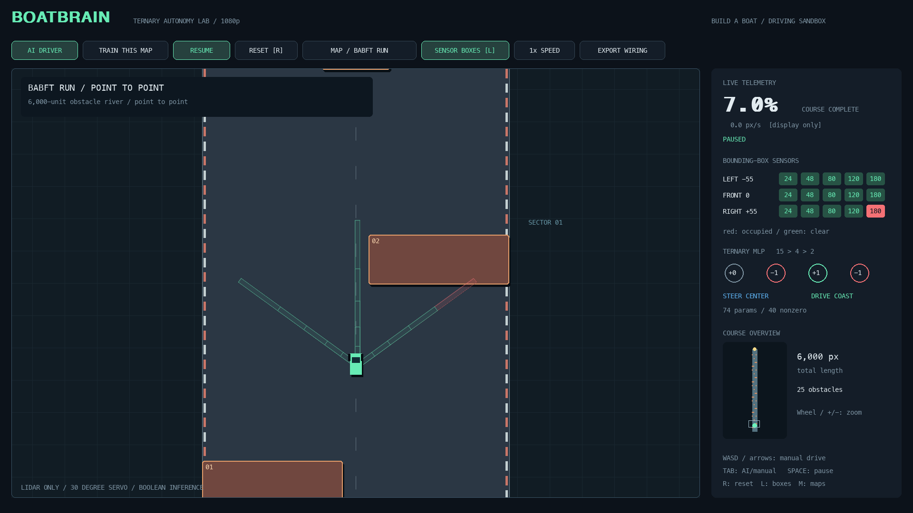
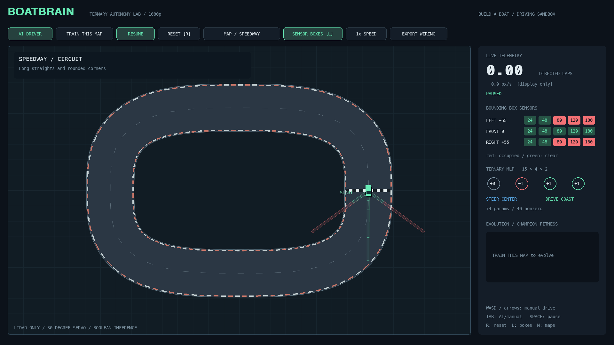
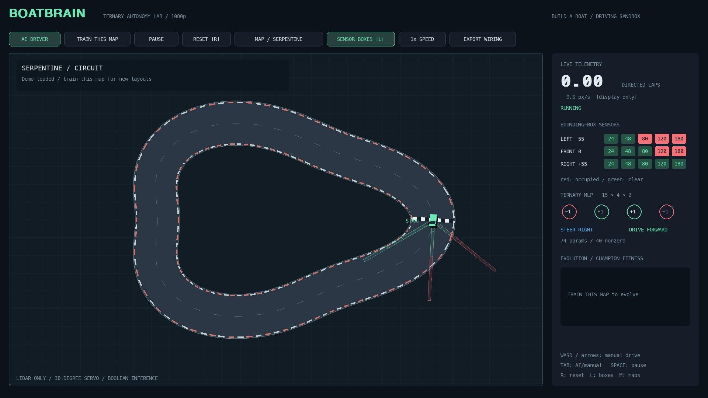
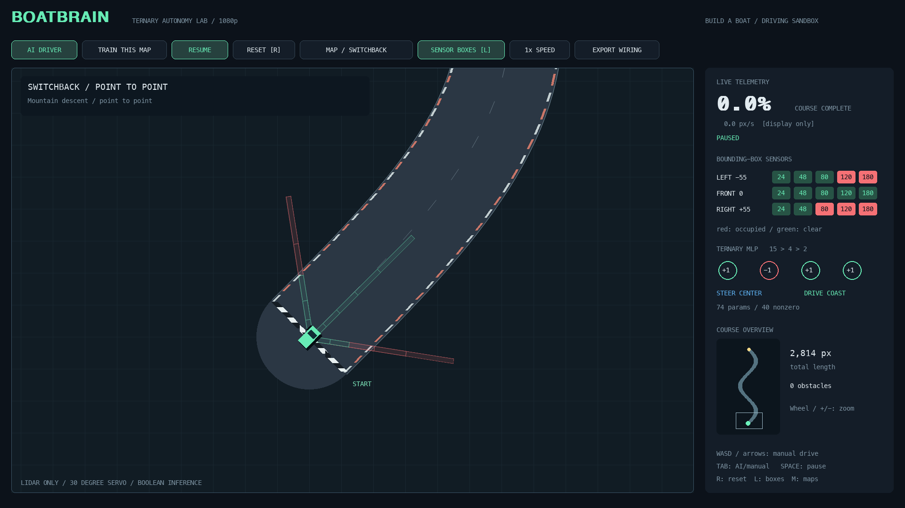
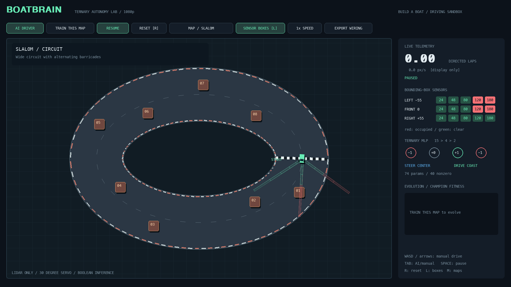
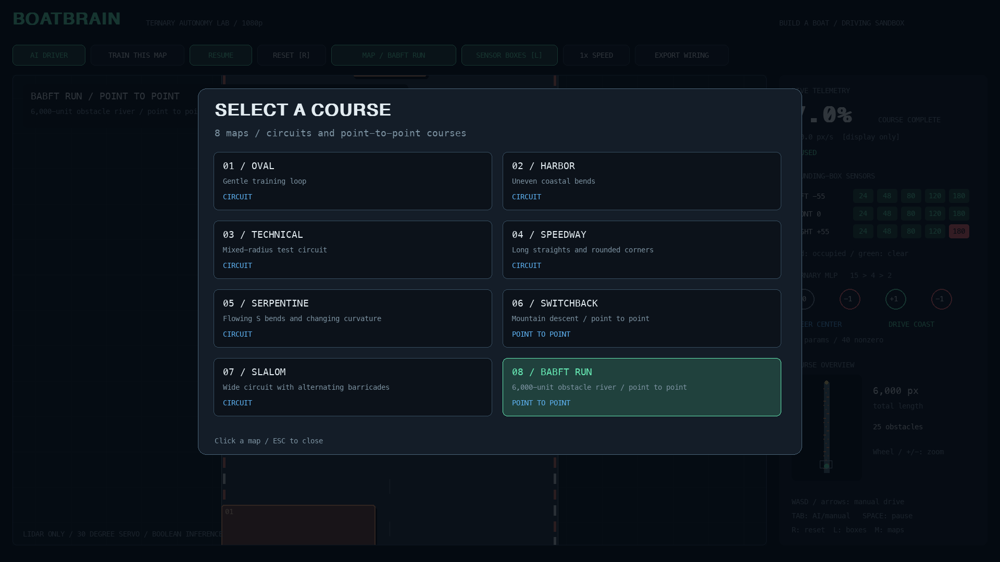

# Eight driving maps / 1080p laboratory

Open the MAP button or press **M**. The default window is **1920 × 1080** and can be resized smaller or larger. Smaller windows scale the entire interface to fit. Text and vector geometry are drawn at the window resolution. Mouse wheel or +/- zooms the camera. Long courses follow the vehicle and show the entire route in a minimap.

| Map ID | Layout | Type |
|---|---|---|
| `oval` | Original gentle training loop | Circuit |
| `harbor` | Original uneven coastal bends | Circuit |
| `technical` | Original mixed-radius evaluation track | Circuit |
| `speedway` | Long straights and rounded rectangular corners | New circuit |
| `serpentine` | A flowing loop with changing curvature | New circuit |
| `switchback` | Winding mountain road, approximately 2,814 units long | New point-to-point course |
| `slalom` | Wide loop with eight staggered block obstacles | New circuit |
| `babft` | 6,000-unit straight river with 25 obstacle blocks | New point-to-point course |

## BABFT Run

A long straight strip inspired by Build a Boat for Treasure's stage progression. It includes alternating side barriers, central islands and pairs of blocks leaving a central gap. The strip is 380 units wide, with 600-unit sector markers. Blocks and walls are visible to lidar and stop the car on impact. A conservative 16px clearance test verifies a connected car-sized route from start to finish. This is an original inspired layout, not a recreation of an official level.

```sh
.venv/bin/python -m boatbrain play --track babft
```



## Speedway



## Serpentine



## Switchback



## Slalom



## Map picker



The existing bundled controller remains the original demo. New obstacle layouts need their own training; TRAIN THIS MAP starts or resumes the selected map's experiment. Three scenarios per map include offsets and reverse driving. Checkpoints are isolated in `runs/lab/<map>/` by default. For long courses, training uses 3,000 steps to allow a full traversal at normal speed; shorter episodes may only cover part of the course.
